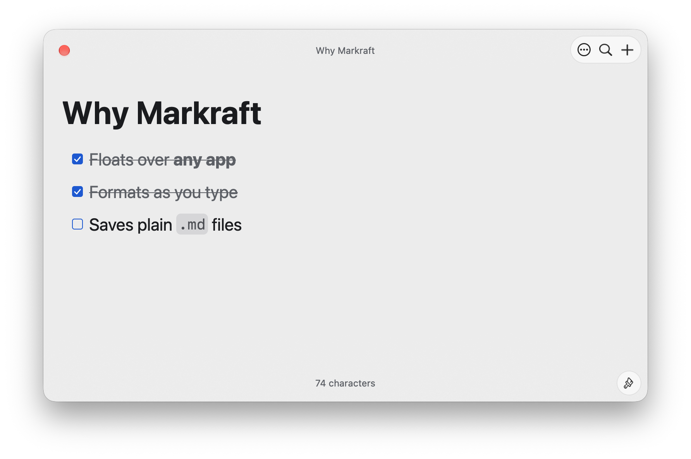
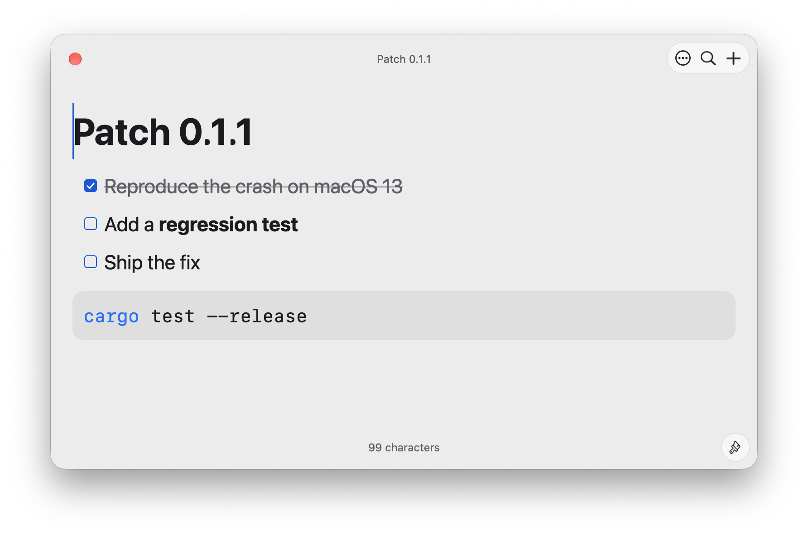
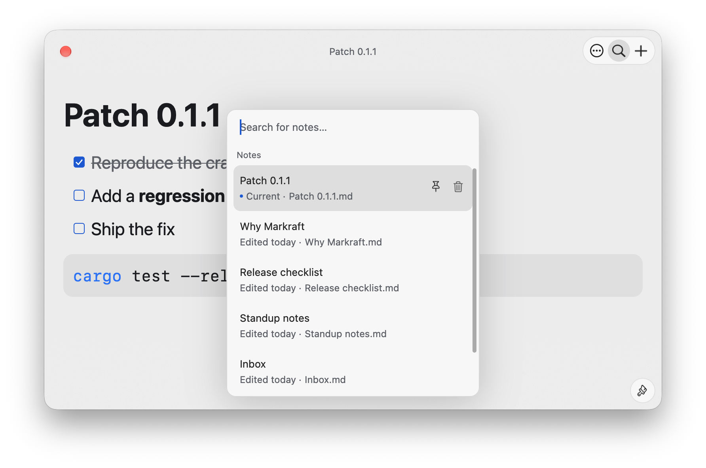
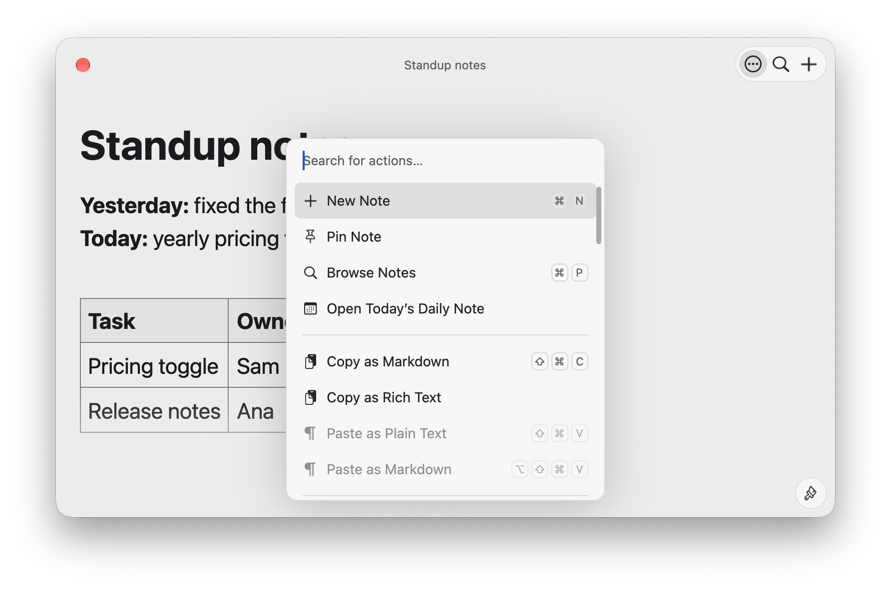

# Markraft

Markraft is a floating Markdown notepad for macOS. Press ⌥N in any app to write a note, and press it again to put the note away. The window stays on top of other apps and grows with the note.

## Live Markdown

Formatting shows as you type. Inline marks such as `**` appear only around the caret. Markraft supports tables that you edit cell by cell, task lists, wiki links with completion, callouts, footnotes and images. It also highlights code blocks and renders LaTeX math offline.

## Plain files

Each note is a plain `.md` file in a folder that you choose, so Obsidian and other editors can open the same notes. A save rewrites only the lines that you edited.

## Keyboard first

⌘P finds and opens a note. ⌘K lists every action with its shortcut, / inserts a block, and vim mode is available in Settings. Daily notes open from the action list.

## Native

Markraft is written in Rust and drawn with GPUI, without a web view. It runs from the menu bar and has no Dock icon.

Website: https://markraft.app
Source: https://github.com/ahonn/markraft
